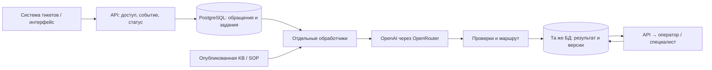

# Phase 2: рост потока и базы знаний

Статус: **предложение для обсуждения, не реализованная инфраструктура**. Рабочий MVP остаётся локальным: один процесс, два одновременных LLM-вызова, до 200 записей в памяти. Поиск, PostgreSQL, очередь и фоновые обработчики пока не подключены. Веб-план доступен в разделе «Эксплуатация».

## Что означает SOP

**Standard Operating Procedure** — стандартная операционная процедура: пошаговая инструкция сотруднику. Например: какие сведения проверить при задержке вывода, что можно сообщить по опубликованным условиям и когда передать обращение специалисту. SOP не даёт модели права одобрять документы, решать AML-вопрос или исход жалобы. Внутренние проверки не становятся текстом для клиента.

У документа нужны владелец, версия, дата действия, продукт/юрлицо, права и признак допустимости раскрытия клиенту. Источники фактов и правила маршрута могут иметь разные уровни доступа. В этом тестовом разрешены четыре публичные страницы: они сохраняются как есть. Внутренние SOP и новые страницы — только следующий согласованный этап.

После появления SOP можно подключить инструменты чтения статусов KYC/платежей и подготовку передачи по заданным шагам. Создание внутренней задачи — отдельная разрешённая операция с подтверждением сотрудника. Возможности и границы описаны в [точке расширения «SOP и инструменты»](architecture_extensions.md#5-sop-и-инструменты-внутренних-систем).

## От текущего MVP к рабочему пилоту

Предлагаемая начальная конфигурация: одна копия FastAPI, PostgreSQL для записей и таблицы заданий, отдельный пул обработчиков с **двумя общими слотами LLM**. Это исходная гипотеза для замера, а не обещание достаточности. PostgreSQL с резервным копированием и проверкой восстановления; вход сотрудников и роли; автоматический перезапуск процессов. Требование переживать отказ хоста потребует разных хостов и резервирования БД, а не нескольких процессов на одном компьютере.

1. **Сохранение до подтверждения.** `POST` проверяет доступ и сохраняет событие, версию обращения и задачу одной транзакцией. Только после commit возвращает `202` и ID задачи. Статус читается отдельным запросом; существующий синхронный контракт MVP потребуется изменить. Обновление вкладки восстанавливает историю из БД. Ошибка записи не выглядит как успешное сохранение.
2. **Повтор доставки.** У события есть уникальная пара «источник + event ID». Для обработки дополнительно фиксируются ticket ID, ревизия текста и версия конфигурации. Повтор события возвращает существующую задачу; новое сообщение клиента не считается дублем. Новый промпт для повторной оценки создаёт явно новую генерацию, а не затирает принятое решение. Уникальные ограничения и транзакции защищают от гонки; [PostgreSQL `ON CONFLICT`](https://www.postgresql.org/docs/current/sql-insert.html) поддерживает обработку конфликтов уникальности.
3. **Захват задания.** В короткой транзакции обработчик выбирает доступную задачу с `FOR UPDATE SKIP LOCKED`, записывает статус, номер попытки и срок аренды, затем освобождает транзакцию до вызова LLM. Продление аренды и номер попытки защищают от одновременного принятия позднего результата. Просроченную аренду можно передать другому обработчику; результат принимается только от действующей попытки и для актуальной ревизии. [PostgreSQL](https://www.postgresql.org/docs/current/sql-select.html#SQL-FOR-UPDATE-SHARE) прямо описывает применение `SKIP LOCKED` для нескольких потребителей таблицы очереди. Срок аренды, индексы, очистку завершённых задач и процедуру возврата зависших задач ещё нужно реализовать и проверить.
4. **Конечный исход.** Статусы: `queued → processing → review_required` либо `manual_required`; у повторов есть `next_attempt_at`, общий deadline и лимит попыток. На 429/временные 5xx — ограниченная пауза и повтор, на постоянную ошибку доступа — человек. Если очередь заполнена, интеграция сохраняет ручной маршрут в исходной системе тикетов; для ручного ввода API сообщает об отказе приёма. Нельзя подтвердить приём и затем молча выбросить задачу.
5. **Сохранение результата.** Черновик, claim/citation, unknowns, маршрут, версии KB/промпта/модели, проверки и расход всех попыток сохраняются до завершения задания. Изменение решения оператором проверяет версию записи; второй сотрудник получает конфликт. Авторизация на сервере не позволяет обычной роли принять обязательное решение специалиста.

Повтор LLM-вызова после сбоя между ответом провайдера и сохранением может быть платным. «Один принятый результат» не означает «ровно один внешний вызов». Неопределённый расход не считаем нулём. При дальнейшей миграции в отдельный брокер понадобятся transactional outbox между БД и очередью, подтверждение после сохранения результата и та же защита от дублей: [RabbitMQ Reliability Guide](https://www.rabbitmq.com/docs/reliability) описывает повторную доставку и необходимость идемпотентной обработки.

## Как увеличивать мощность

10 000 / 30 ≈ **333 обращения в день**. При равномерном потоке 24 часа в сутки это около **0,23 обращения/мин**; если весь поток приходится на 8 часов в день — около **0,69/мин**. Ни один вариант не описывает реальный пик. Из системы тикетов нужны поминутный поток и всплески, языки/темы, средние и хвостовые размеры текста, квоты провайдера, время каждого этапа.

Оценка необходимых одновременных вызовов:

`C ≈ ceil(λ_peak × E[сумма секунд всех LLM-вызовов на обращение] / u)`

Здесь `λ_peak` — выбранный пиковый поток в обращениях/с, `u` — целевая загрузка с запасом. Сумма включает классификатор, генератор, проверяющего, правки и повторы, если они подключены. Это приближение по средней занятости слотов, не гарантия задержки p95. Число процессов и число слотов LLM не равны: один асинхронный процесс способен держать несколько вызовов.

**Условный пример:** 20 обращений/мин, средняя сумма LLM-времени 15 с, `u=0,7`: `ceil(20/60 × 15 / 0,7) = 8`. Вторая модель увеличивает сумму времени; квоты запросов/мин и токенов/мин могут запретить восемь слотов. Эти числа не измерены для текущего MVP. Целевую загрузку и ожидание проверяем на конкретном профиле очереди.

| Что наблюдаем | Что меняем | Что проверяем |
|---|---|---|
| Стареет очередь, провайдер отвечает стабильно, квота свободна | Добавляем слоты и обработчики, с верхним пределом и постепенным уменьшением после спада | Сократилось ожидание, общий лимит и бюджет соблюдены |
| 429 или расход токенов достиг квоты | Ограничиваем общий поток, сжимаем контекст после eval либо согласуем квоту | Ошибок меньше; очередь не растёт бесконечно, есть ручной маршрут |
| API медленно принимает события/показывает историю | Устраняем медленные запросы/блокировки, затем добавляем копии за балансировщиком | Приём отделён от LLM; записи общие, ограничения не умножаются |
| Растёт время запросов БД и захвата задач | Проверяем индексы, пул соединений, очистку истории, конфликты и нагрузку очереди; при подтверждённом ограничении выделяем брокер | Узкое место устранено на том же нагрузочном профиле |
| Долго генерирует сам провайдер | Проверяем размер контекста/ответа, число этапов, модель и проверенный резерв | Сравниваем качество и полную стоимость; новые процессы не считаем ускорением модели |
| Копятся готовые черновики у специалистов | Измеряем ёмкость человеческой очереди, меняем назначение и процесс команды | Время проверки, правки, отказы и повторные обращения; ускорение генерации не скрывает задержку review |

Общий лимит запросов, токенов и параллельности хранится вне отдельного процесса. Сейчас `Semaphore(2)` и история локальны; запуск нескольких копий в таком виде разделит записи и умножит разрешённую параллельность. Память процессов обычно не общая — это описано в [FastAPI: Deployment Concepts](https://fastapi.tiangolo.com/deployment/concepts/#memory-per-process). После выноса состояния API и обработчики масштабируются независимо. Кластерный оркестратор становится вариантом управления развёртыванием по потребности команды, а не обязательным следствием 10 000 тикетов/месяц.

## Как растут KB и SOP

Путь обновления: **черновик → diff и проверка владельцем → фрагменты/индекс → тесты затронутых вопросов → публикация одной версии**. Исходники, фрагменты и индекс связаны manifest и хешами. При изменении только части базы повторно готовятся изменённые фрагменты. Индекс строится до публикации; запрос закреплён за версией. Новые запросы, генератор, проверяющий и оператор должны видеть совместимые источники.

Неутверждённые черновики, затронутые изменением, требуют повторной подготовки. Ответ, сделанный по старой версии, не выдаётся за актуальный. Технический откат индекса или модели допустим только с текущей действующей политикой. Если старая политика уже недействительна, возвращать её нельзя: до исправления — человек.

Когда полный контекст перестаёт укладываться в бюджет или ухудшает качество, вводим поиск: фильтры продукта/юрлица/даты/прав → BM25 baseline → при измеренном выигрыше семантический поиск и объединение → при ошибках ранжирования reranker. Детали, источники и метрики в [схемах расширений](architecture_extensions.md). Кэш ключуется версией базы, фильтрами и запросом; персональные результаты не разделяются между клиентами. Внутренний документ, разрешённый специалисту, всё равно не означает разрешение раскрыть его клиенту. Новая база проходит проверку на посторонние инструкции и конфликты.

## Доступность, измерения и приёмка

Резервы и rollback описаны в [плане резервов](architecture_extensions.md#4-резервы-и-rollback). Глобальный deadline и бюджет включают все попытки. Для ошибки OpenRouter нужен отдельный согласованный адаптер либо человек. Любой резерв проходит тот же eval и проверки. Новый этап/модель/промпт/индекс выпускается после независимого экспертного набора, затем ограниченного пилота с возможностью возврата совместимой проверенной конфигурации. Отказ по безопасности не обходим сменой модели.

Наблюдаем: подтверждённые события и конечные исходы; глубину и возраст очереди; p50/p95 до черновика и отдельно время провайдера; 429/таймауты и повторы; ошибки схемы, фактов и маршрута; расход всех этапов; доступность БД, соединения и восстановление; время человека, правки и повторные обращения. Журналы по умолчанию содержат ID, версии, коды и обезличенные сведения. Назначаются ответственные за инфраструктуру, базу и качество.

Проверки будущей реализации:

- Нагрузка на синтетических данных с подставным LLM: 10 одновременных → всплеск 50 → 1 обращение/с 10 минут. Это предложенный тестовый профиль, не утверждение о реальном трафике. После получения фактических пиков заменить его воспроизведением этих пиков и тестом с согласованным запасом.
- Сбой обработчика во время вызова и после него, недоступная БД, дубли событий, новое сообщение во время генерации, переполнение и deadline. Ни одной потерянной подтверждённой задачи; один актуальный принятый результат; старые попытки не перезаписывают новый; расход повторов виден.
- Увеличение числа обработчиков/копий не умножает общий лимит. Проверка резервов, ограничение повторов и ручной исход при исчерпании времени/бюджета.
- Обновление/откат индекса, конфликт источников, закрытый SOP, одновременное решение двух сотрудников, восстановление резервной копии.
- Экспертная проверка фактов, запретов и маршрута на новом наборе; сравнение активного времени операторов с ручной обработкой. Отдельно измеряется p95 и стоимость на живом провайдере выборочными прогонами после проверки инфраструктуры со stub.

До рабочего пилота владелец продукта утверждает p95 до черновика, максимальное ожидание/размер очереди, допустимый ручной объём, бюджет на обращение/день, квоты, требования восстановления и критерии качества. Критические нарушения не должны появляться в согласованном приёмочном наборе; это не статистическая гарантия отсутствия ошибок в production. Будущая схема ещё не проходила эти проверки. После добавления инфраструктуры её расходы и сопровождение добавляются в business case вместе со временем команды.

## Связь с разбором Telegram-канала

Из №124 берём ограниченные полномочия и простую архитектуру; из №117 — фиксированный workflow; из №115/122 — trace и управляемые отказы; из №145 — одну версию контекста; из №136 — выбор поиска по ошибкам; из №106/144 — независимую оценку изменений; из №81/112 — замер человеческого времени. Ссылки и оговорки находятся в [разборе канала](../research/06_telegram_practices_review.md).

PostgreSQL, аренда заданий, outbox, лимиты и порядок миграции — наши инженерные предложения, проверенные по приведённым первичным техническим источникам. Не приписываем каналу выбор конкретной БД, размера пула, профиля нагрузки или доказанную ёмкость Valetax.
